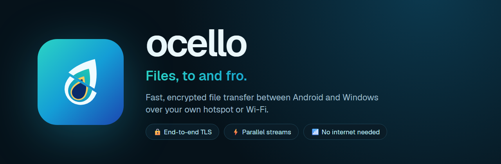
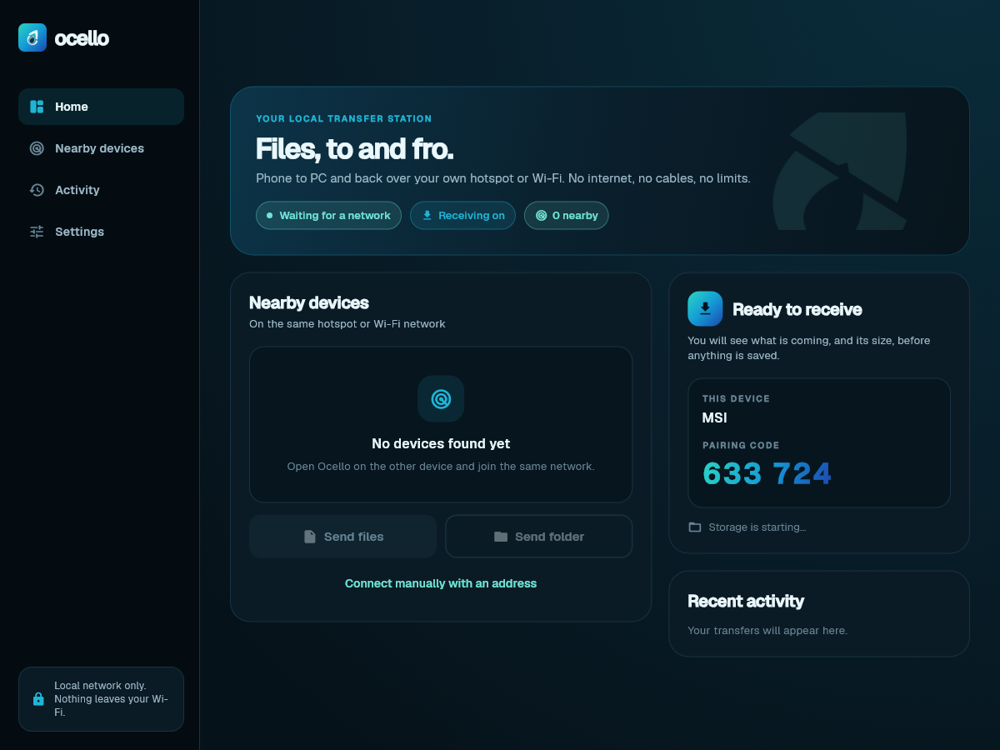
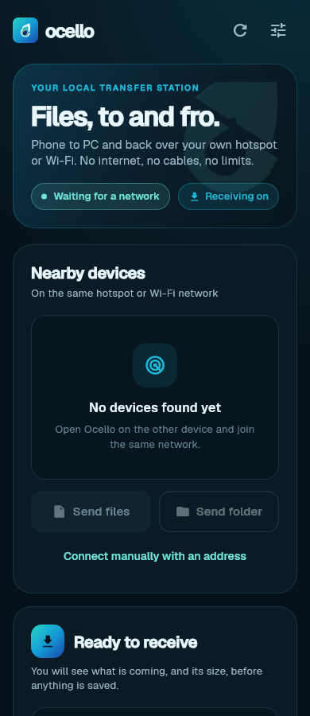
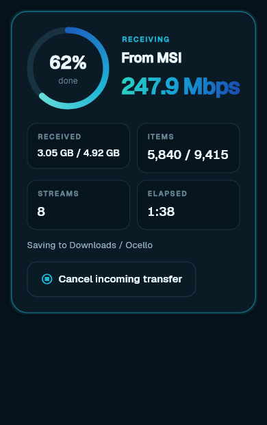
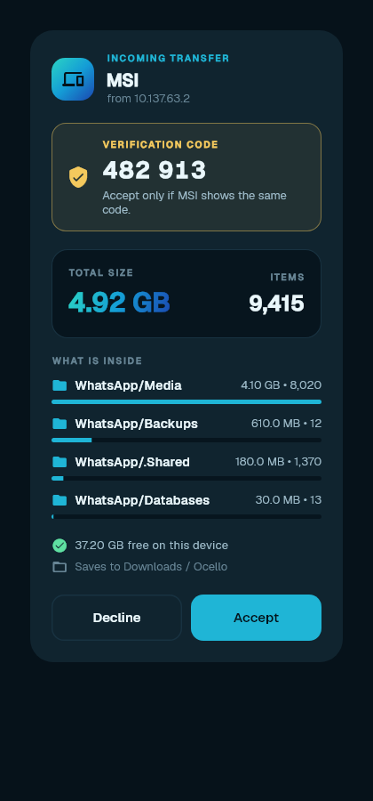
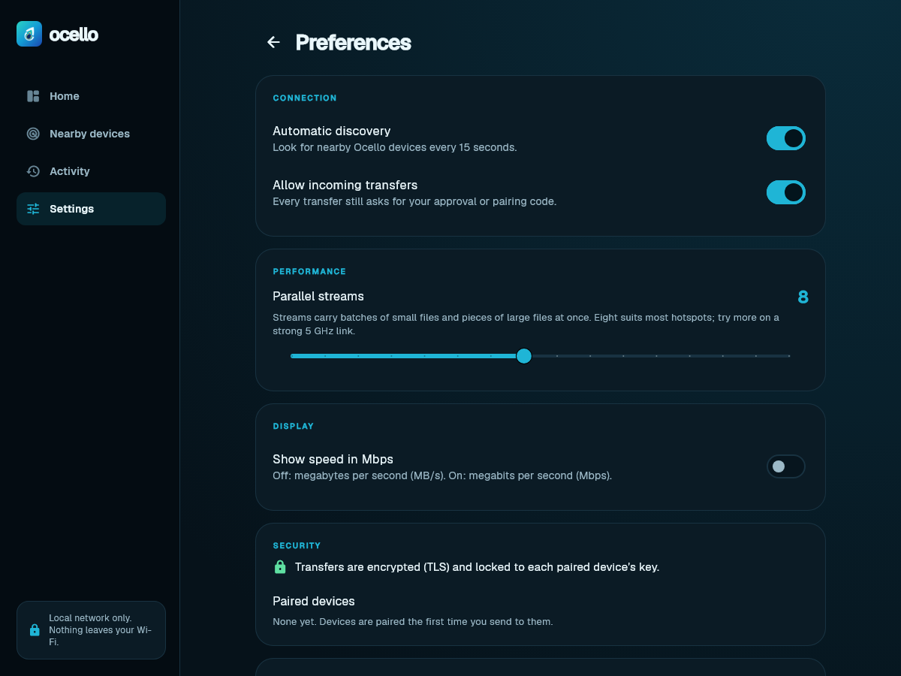

  

  
  
  
  
  

  <b>Fast, encrypted file transfer between Android and Windows over your own hotspot or Wi-Fi.</b> 
  No internet, no cables, no accounts.

  <a href="../../releases/latest"><b>⬇&nbsp; Download for Android and Windows</b></a>

  
  &nbsp;
  

## Features

|   |   |
|---|---|
| ⚡ **Fast** | Thousands of small files travel in batches; large files are split across up to 16 parallel streams. A 4.9 GB WhatsApp folder (9,415 files) moved over a phone hotspot at about 250 Mbps. |
| 🔒 **Encrypted** | Every transfer uses TLS, locked to each device's own key. Pairing shows the same six-digit code on both screens, so nobody can sit in the middle. |
| 👀 **You decide** | Before anything is saved you see who is sending, from which address, the total size, what is inside and whether it fits. |
| 📱 **Background transfers** | On Android, transfers keep running while you use other apps, with a progress notification and a Cancel button. Either side can cancel. |
| 🗂️ **Whole folders** | Folder structure is kept, odd file names are cleaned up, and you choose where received files go. |
| 🛡️ **Private** | Everything stays on your local network. No cloud, no sign-in, no analytics. See the [privacy policy](PRIVACY.md). |

<table>
  <tr>
    <th>Transfer in progress</th><th>Approve with a verification code</th><th>Settings</th>
  </tr>
  <tr>
    <td></td>
    <td></td>
    <td></td>
  </tr>
</table>

## Download

Get both apps from the **[latest release](../../releases/latest)**.

| Platform | File | Requirements |
|---|---|---|
| Android | `Ocello-<version>-android.apk` | Android 5.0 or newer |
| Windows | `Ocello-<version>-windows-x64.zip` | Windows 10 or 11, 64-bit |

**Android:** open the APK on your phone, allow installing from your browser or file manager if asked, then allow notifications when Ocello starts.

**Windows:** extract the whole zip and run `ocello.exe`. The app is not code-signed yet, so SmartScreen may show *Windows protected your PC*: choose **More info → Run anyway**. When Windows Firewall asks, allow Ocello on **private networks**.

Each release lists SHA-256 checksums in `SHA256SUMS.txt` (`certutil -hashfile <file> SHA256` on Windows).

## How to use

1. Connect both devices to the same hotspot or Wi-Fi. Internet is not needed.
2. Open Ocello on both; they find each other within seconds.
3. Pick the device, then **Send files** or **Send folder**.
4. On the receiver, check the **verification code** matches the sender's screen, then tap **Accept**.

Received files go to **Downloads/Ocello** on Android and **Downloads/Ocello Received** on Windows, or to a folder you choose in Settings.

## Tips for top speed

- Set the phone's hotspot to **5 GHz** (Hotspot settings → Band). 2.4 GHz tops out around 100–150 Mbps.
- Keep the devices close to each other, with few walls between them.
- Try 8 to 16 parallel streams in Settings and keep the fastest.

## FAQ

<b>The devices don't see each other</b>

Some hotspots and guest Wi-Fi networks isolate devices from each other. Check that both are on the same network, then use **Connect manually with an address** with the address and six-digit code shown on the receiver. On Windows, make sure Ocello is allowed through the firewall on private networks.

<b>Does Ocello use my mobile data?</b>

No. Files go directly between the two devices over Wi-Fi. A hotspot works even with mobile data turned off.

<b>Is it safe on public Wi-Fi?</b>

Transfers are encrypted and need your approval, but other people on the network can see this device's name while Ocello is open. On networks you don't trust, turn off <i>Automatic discovery</i> and <i>Allow incoming transfers</i> when you're not using them. Details are in <a href="SECURITY.md">SECURITY.md</a>.

<b>Android says the app can't be installed</b>

If you installed a build from before 3.2, uninstall it first; it was signed with a different key. Updates from 3.2 onwards install over the existing app.

<b>Can I use it between two phones or two PCs?</b>

Yes. Any two devices running Ocello on the same network can send to each other.

## Security and privacy

Read the [security overview](SECURITY.md) for how transfers are protected and how to report a vulnerability privately, and the [privacy policy](PRIVACY.md) for what stays on your device. Changes are listed in the [changelog](CHANGELOG.md).

---

   
  Ocello is free to use (<a href="LICENSE.md">license</a>). This repository hosts releases only; the source code is not published.

